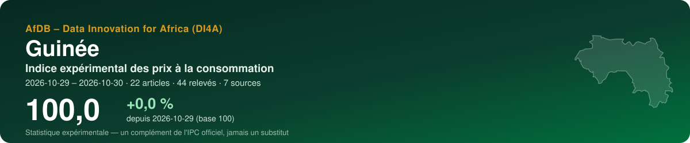
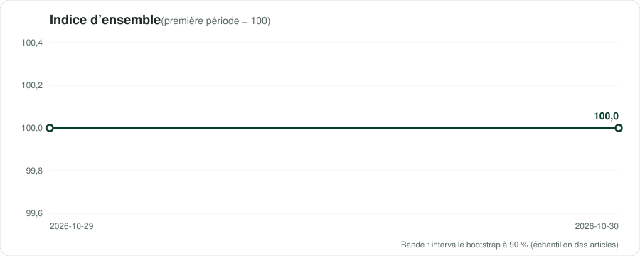
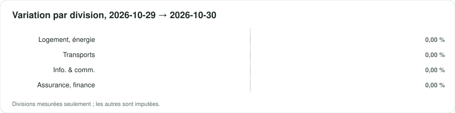
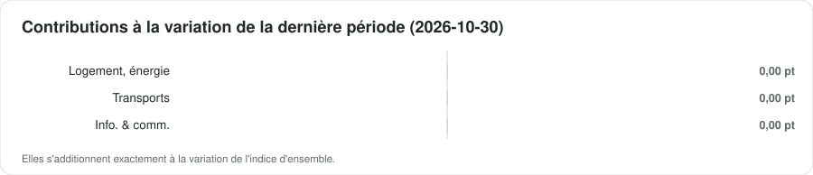

<p align="center"></p>

<p align="center">
  <a href="https://datainnov4africa-web.github.io/cpi-gn/"><b>▶ Ouvrir le tableau de bord</b></a> · <a href="README.md">English version</a>
</p>

<p align="center">
      
</p>

## En bref

| Indicateur | Valeur |
|---|---|
| **Indice d'ensemble** | **100,0** (+0,0 % depuis 2026-10-29) |
| Variation de la dernière période | +0,00 % |
| Fenêtre | 2026-10-29 → 2026-10-30 · par date de collecte |
| Données | 44 relevés · 22 articles · 7 sources |
| Divisions COICOP mesurées | 3 / 13 |
| Pondérations | officielles — Institut National de la Statistique (INS), 'Indice National Harmonisé des Prix à la Consommation (INHPC)', monthly note for June 2026 (Note_ |
| Devise | GNF (FG) |

> [!IMPORTANT]
> Statistique expérimentale construite à partir de prix publiés en ligne (boutiques, régulateurs, services publics, données de marché). Un complément de l'indice officiel des prix de l'institut national de la statistique — jamais un substitut.

<p align="center"></p>

## Messages clés

| Confiance | Message | Pourquoi |
|---|---|---|
| 🟠 Faible | Entre 2026-10-29 et 2026-10-30, l'indice expérimental a varié de +0,0 % (2 périodes, 22 articles). | Des dates de collecte dans un seul mois : un mouvement de court terme, pas encore une tendance mensuelle. |
| 🟡 Moyenne | Sur la dernière période, la plus forte contribution vient de la division 08 (Information et communication) : +0,00 point de pourcentage. | Les contributions s'additionnent exactement à la variation de l'indice d'ensemble. |
| 🟠 Faible | Les divisions mesurées pèsent 22 % du panier officiel. | Être atteint n'est pas être représenté : un groupe peut être suivi par quelques articles en ligne éloignés de ses variétés officielles. Les groupes non mesurés sont imputés par ceux qui le sont. |
| 🟡 Moyenne | Échantillonnage des articles : le dernier indice se situe entre 100,0 et 100,0 dans 90 % de 100 réplications bootstrap. | L'intervalle couvre le choix des articles collectés, pas le biais des prix en ligne face aux prix en magasin. |

## Par division COICOP

<p align="center"></p>

| | Division | Poids % | Articles | Variation % | Contribution, dernière période (pt) |
|---|---|---:|---:|---:|---:|
| 01 | Produits alimentaires et boissons non alcoolisées | 39,3 | — | imputée | — |
| 02 | Boissons alcoolisées, tabac et stupéfiants | 0,7 | — | imputée | — |
| 03 | Articles d'habillement et chaussures | 7,5 | — | imputée | — |
| 04 | Logement, eau, électricité, gaz et autres combustibles | 4,6 | 8 | 0,00 | 0,000 |
| 05 | Meubles, équipements ménagers et entretien courant | 3,3 | — | imputée | — |
| 06 | Santé | 3,7 | — | imputée | — |
| 07 | Transports | 10,8 | 2 | 0,00 | 0,000 |
| 08 | Information et communication | 6,5 | 5 | 0,00 | 0,000 |
| 09 | Loisirs, sports et culture | 1,4 | — | imputée | — |
| 10 | Services d'enseignement | 1,0 | — | imputée | — |
| 11 | Restaurants et services d'hébergement | 16,8 | — | imputée | — |
| 12 | Assurances et services financiers | 0,0 | 7 | 0,00 | — |
| 13 | Soins personnels, protection sociale et divers | 4,5 | — | imputée | — |

*Imputée* : aucun prix lu pour la division ; elle évolue comme les divisions mesurées (Manuel de l'IPC 2020, ch. 6).

<p align="center"></p>

## Sources

11 sources actives au registre, 20 exclues avec leur motif. Chaque requête du robot lit d'abord le robots.txt ; un refus est consigné, jamais contourné.

| Source | Type | COICOP | Statut | Relevés de cette exécution |
|---|---|---|---|---:|
| [Orange Guinée — mobile data bundles (weekly and monthly)](https://osiris.sn/cout-de-l-internet-quelle-est-la-place-de-la-guinee-par-rapport-a-ses-voisins.html) | tarif réglementé | 08 | partielle | 10 |
| [SEG — domestic water tariff by consumption band](https://guineenews.org/2025/03/30/pour-resoudre-linsuffisance-deau-et-delectricite-en-republique-de-guinee-faut-il-ouvrir-les-monopoles-la-societe-des-eaux-de-guinee-seg-et-lelectricite-de-guinee-edg-a-linvestissement/) | tarif réglementé | 04 | partielle | 8 |
| [Société Générale Guinée — retail banking fee schedule (individuals)](https://guinee.societegenerale.com/fileadmin/user_upload/guinee/PDF/Tarifs_Clipri.pdf) | tarif réglementé | 12 | partielle | 8 |
| [EDG — household electricity tariff by consumption band](https://guineenews.org/2025/03/30/pour-resoudre-linsuffisance-deau-et-delectricite-en-republique-de-guinee-faut-il-ouvrir-les-monopoles-la-societe-des-eaux-de-guinee-seg-et-lelectricite-de-guinee-edg-a-linvestissement/) | tarif réglementé | 04 | partielle | 6 |
| [Orange Money Guinée — withdrawal fee grid](https://guineenews.org/2025/01/15/monnaie-electronique-orange-money-reduit-encore-ses-frais-de-retrait-de-1/) | tarif réglementé | 12 | partielle | 6 |
| [Government pump prices — petrol and diesel](https://guineenews.org/2022/06/01/guinee-le-prix-du-litre-dessence-passe-de-10-mille-a-12-mille-gnf-officiel/) | tarif réglementé | 07 | vérifiée | 4 |
| [Government pump price — kerosene (pétrole lampant)](https://guineenews.org/2022/06/01/guinee-le-prix-du-litre-dessence-passe-de-10-mille-a-12-mille-gnf-officiel/) | tarif réglementé | 04 | partielle | 2 |
| [INS — INHPC monthly note, Tableau 21 'average prices of essential products by region'](https://stat-guinee.org/images/Documents/Publications/INS/infra_annuelles/IHPC/INHPC_2026/Note_INHPC_Juin_2026_Guinee_V1.pdf) | prix de marché | 01, 04, 07 | partielle | 0 |
| [World Bank RTFP — monthly food price estimates by product and market (20 markets)](https://microdata.worldbank.org/catalog/6165) | prix de marché | 01 | partielle | 0 |
| [World Bank — official CPI (annual)](https://api.worldbank.org/v2/country/GIN/indicator/FP.CPI.TOTL) | référence officielle | — | partielle | 0 |
| [IMF DataMapper — inflation (WEO)](https://www.imf.org/external/datamapper/api/v1/PCPIPCH/GIN) | référence officielle | — | partielle | 0 |

<details><summary>20 sources exclues et pourquoi</summary>

- **WFP market prices (HDX)** — Le jeu « Guinea - Food Prices » existe mais couvre du 15/01/2008 au 15/10/2023 (modifié le 18/08/2024, annoncé « mensuel ») : trois ans de retard. Le tableau de prix de l'INS et le RTFP donnent les prix de 2026. À réactiver si les mises à jour reprennent.
- **FEWS NET — Guinea** — La page Guinée de FEWS NET ne liste aucune analyse après la Key Message Update de mars 2017 et aucun bulletin de prix pour la Guinée ; le Data Explorer n'était pas joignable. Aucune donnée de prix récente à attendre.
- **Ministry of Commerce — ceiling prices of staples (Ramadan/Lent 2026)** — Protocole signé le 16 févr. 2026 (DNCIC, ministère du Commerce) plafonnant les prix du riz importé, du sucre, de l'huile végétale, de l'oignon, du lait en poudre, de la farine et du poulet jusqu'au 30 juin 2026, avec une grille pour le Grand Conakry. Aucun montant lisible (KOACI n'en donne pas ; la copie AllAfrica n'a pas chargé) et les plafonds ont expiré. Second approfondissement : les copies AllAfrica ont été lues. 17 févr. 2026 : signataires DNCIC, CCIAG et Douanes (DGD) ; les Douanes maintiennent des valeurs mercuriales de 100 USD/t pour le riz, 200/t pour le sucre, 600/t pour le poulet ; le tableau de prix « ci-dessous » manque dans le texte. 18 févr. 2026 (Aminata.com) : un seul chiffre, « le sac de 50 kg [sucre] ne doit pas excéder 350000 à Conakry » ; chaque préfecture a son propre plafond. Un protocole antérieur en vigueur dès le 12 juill. 2025 (Guinéenews, 8 juill. 2025, publireportage) couvrait riz, sucre, huile, farine, oignon, poulet et viande à Conakry, lui aussi sans chiffres publiés. Un plafond expiré sur un seul produit : inutilisable ; les grilles complètes sont demandées à la DNCIC.
- **Press market-price reports, Conakry ('panier de la ménagère')** — Lu le 29/10/2026 : Guinéenews, 8 mars 2025, marchés de Conakry non nommés : riz Bangladesh 315 000 GNF le sac de 50 kg, sucre 350 000 les 50 kg, huile végétale 310 000 les 20 L, huile de palme 250 000 les 20 L, viande 60 000/kg, œufs 50 000–60 000 le plateau. Des articles semblables ont paru en août 2023, janv. 2024 et mars 2024, surtout autour du Ramadan ; aucun trouvé pour 2026. Irréguliers, marchés non nommés, fourchettes, et prix au kilo incohérents avec les prix au sac (350 000/50 kg donnés pour « 8 000 GNF le kilogramme ») : au mieux un recoupement du tableau de l'INS, pas une série.
- **Official bread price (baguette)** — Le pain est à prix contrôlé : un communiqué du ministre du Commerce (vers le 3 déc. 2021) a porté la baguette simple de 2 000 à 2 250 GNF et la double de 4 000 à 4 500 GNF (Guinéenews, 4 déc. 2021). Un communiqué du ministère du Commerce de juillet 2025 (AllAfrica, 25 juill. 2025) met en garde les boulangers contre des hausses « injustifiées » et renvoie aux « prix officiels » et à « la réglementation en vigueur », sans chiffre. Le prix en vigueur en 2026 n'est donc pas confirmé ; le pain figure en outre dans la liste de produits du RTFP. À réactiver avec le texte ministériel actuel.
- **FAO GIEWS country brief / FPMA tool — Guinea** — Lu le 29/10/2026 : la note pays du SMIAR pour la Guinée date du 21 mars 2025 et ne donne que l'inflation alimentaire (7,7–9 % en 2024, 7,1 % en janvier 2025), sans prix de marché ; elle cite l'outil FPMA sans nommer de série pour la Guinée. Deux recherches n'ont trouvé aucune série FPMA pour la Guinée (ex. riz à Conakry) à confirmer. À revérifier dans l'outil FPMA depuis un navigateur.
- **Cement price (50 kg bag)** — Lu le 29/10/2026 : presse professionnelle (27 juin 2025) : pénurie, sac à 95 000–100 000 GNF contre 70 000–75 000 pour le 42,5, sans préciser si un prix est administré. Aucun texte de plafonnement trouvé. Une seule fourchette de presse de 2025 pour un petit poste de la division 04 (matériaux d'entretien) : non retenue.
- **Urban and inter-urban passenger fares (June 2022)** — Tarifs fixés le 10 juin 2022 par la Direction Nationale des Transports Terrestres et la faîtière des transporteurs après la hausse du carburant. Approfondissement : les articles sur l'urbain (25 juin 2022) et l'interurbain (27 juin 2022) ont été relus et les deux tableaux sont absents du texte servi (titres seulement, sans doute des images). Seuls tarifs lisibles, une ligne Conakry–Kankan : minibus 130 000 → 150 000 GNF et taxi 200 000 → 220 000 GNF (Guinéenews, 8 juill. 2022), sans confirmation ultérieure. Une ligne interurbaine de 2022 ne représente pas le transport de voyageurs ; aucun tarif urbain trouvé. À réactiver avec le tableau de la DNTT. Second approfondissement : une recherche de plus (taxi, minibus et bus urbains 2025–2026) n'a donné qu'un article de réajustement de sept. 2021 et des estimations collaboratives de course de taxi.
- **Butane (LPG) refill prices** — Prix en vigueur inconnu. Prix administrés depuis le 1er sept. 2021 (protocole du ministère des Hydrocarbures du 17 août 2021) : 6 kg 69 000 GNF, 12,5 kg 143 500 GNF (Guinéenews, 30 août 2021). Le communiqué du FAPGAZ du 2 août 2023 les a baissés à 60 000 et 130 000 GNF, mais deux semaines plus tard les détaillants demandaient encore 65 000–80 000 pour 6 kg et un importateur parlait d'une « proposition » en attente d'un arrêté conjoint (Guinéenews, 16 août 2023). Aucun texte ultérieur trouvé. Le gaz ne concerne en outre que peu de ménages (le charbon domine, tableau de l'INS). Second approfondissement : une recherche de plus (prix 6 kg et 12,5 kg en 2025–2026) n'a renvoyé que les articles de 2021 et 2023.
- **Public university master's fees** — Un seul article : frais de master dans le public ramenés à 8 000 000 GNF par an (16 000 000 pour le cycle), annoncés sur la page Facebook du ministre (Guinéenews, 21 févr. 2025), sans texte ni date d'effet. Il ferait paraître la division 10 couverte en ne mesurant qu'une petite part des dépenses d'éducation des ménages. Approfondissement : aucun droit d'inscription en licence dans les universités publiques (UGANC ou autres) ni aucune grille de scolarité n'a été trouvé. Second approfondissement (deux recherches) : aucun texte sur les droits d'inscription 2025-2026 dans le public ; la fiche de l'Université Kofi Annan dans un annuaire de l'enseignement (mise à jour le 23 janv. 2026) ne donne aucun frais, et la question d'un lecteur du 19 oct. 2026 sur les frais 2026-2027 est restée sans réponse.
- **Private schools — capped registration fees (MEPU-A, 2022)** — Communiqué du ministre de l'Enseignement pré-universitaire (30 août 2022), dès l'année 2022-2023 : inscription dans le privé plafonnée à 150 000 GNF et réinscription à 100 000 GNF sur tout le territoire. Ce sont des plafonds, pas des prix payés, ils excluent les mensualités qui font l'essentiel de la dépense, et rien ne les confirme pour 2025-2026 (une union de consommateurs dénonçait le 6 sept. 2025 une « fixation fantaisiste » des frais du privé, sans chiffres). Non représentatif de la division 10.
- **Online shops / marketplaces (groceries, clothing, furnishings, personal care)** — Aucune boutique web guinéenne avec des prix en GNF en dix recherches sur deux passages (épicerie, habillement, cosmétiques, meubles, électroménager, supermarchés en ligne, boutiques Shopify/WooCommerce avec « GNF » et « ajouter au panier », CoinAfrique — rien pour la Guinée). Aucune place de marché Jumia connue pour la Guinée. Les plateformes trouvées sont des applications (MonMarché, Arabinene, Fifoow, lancée en févr. 2026 : petites annonces, sans prix dans l'article) ou de l'occasion (Seconde Main 224, prix fixés par les vendeurs : hors champ de l'IPC). Les supermarchés de Conakry n'ont pas de liste de prix en ligne. Les divisions 03, 05 et 13 restent imputées. Second approfondissement (cinq recherches de plus : « boutique en ligne Conakry GNF », enseignes Prosper/City Dia/Leader Price avec boutique web, téléphones et électroménager, cosmétiques/parapharmacie/habillement, et l'expression exacte « Ajouter au panier » avec « GNF ») : seulement des blogs d'agences web, des fiches d'applications et des convertisseurs de devises ; aucune boutique avec un catalogue en GNF.
- **Rent and classified-ad portals (Conakry)** — Deux recherches n'ont trouvé aucun portail de loyers avec des annonces datées en GNF pour Conakry ; seulement des articles de presse sur la crise du logement et des sites de location de vacances (USD, touristes).
- **Food-delivery apps and restaurant menus (Dineroo, GuiFood, Clic GN)** — Applications mobiles uniquement, aucun menu web public avec prix. Approfondissement (quatre recherches) : Clic GN est une application de livraison pour étudiants dont les menus sont « dans l'application » (fiche App Store) ; aucun service Glovo ou Yango Food en Guinée n'a été trouvé ; aucun restaurant de Conakry ne publie une carte de prix datée sur le web (annuaires et sites d'avis sans prix). La division 11 (16,8 % des poids) reste imputée. Second approfondissement (quatre recherches) : les nouvelles 2026 de Glovo/Yango/Jumia Food ne concernent que la Côte d'Ivoire et le Nigeria, aucun lancement à Conakry ; aucun site de restauration rapide ou de restaurant avec une carte en GNF ; aucun prix publié des repas des restaurants universitaires. Restent seulement des estimations collaboratives (menu du midi 103 707 GNF, menu fast-food 73 835 GNF sur Expatistan ; voir gn_cost_of_living_sites).
- **Hotel rates in Conakry (booking metasearch)** — Lu le 29/10/2026 : tarifs à la nuit en EUR pour un séjour donné (31 oct.–1er nov. 2026), ex. Hakaba 35 €, Zambezi Inn 48 €, Palm Camayenne 193 €, Radisson Blu 357 €, avec un même hôtel affiché à deux prix sur la même page (Onomo 143 € et 114 €). Hôtels d'affaires/touristes en euros, prix dynamiques et liés au séjour : ils mesurent une part négligeable des dépenses des ménages en division 11, que les poids de l'EHCVM placent surtout sur les repas hors domicile. Robots.txt non lu ; les métamoteurs de voyage interdisent en général les pages de résultats. Second approfondissement : une recherche de pages tarifaires d'hôtels de Conakry en GNF n'a renvoyé que des agrégateurs (combien-coute, Kayak, Momondo, Skyscanner, lastminute), aucune page de tarifs publics datée d'un hôtel.
- **Cost-of-living aggregators (combien-coute.net, Numbeo, Expatistan)** — Lu le 29/10/2026 : « plat pour le déjeuner » en moyenne 8,3 €/personne (environ 82 179 GNF), fourchette 4,1–12 €, mis à jour le 21/10/2026, données attribuées à Numbeo, nombre de contributions non indiqué ; le même site et Expatistan donnent aussi bière, cigarettes et nuits d'hôtel. Estimations collaboratives orientées expatriés, converties en euros, échantillon inconnu, pas des prix des ménages : inutilisables pour 02 ou 11.
- **Beer and cigarette retail prices** — Une recherche n'a trouvé aucun prix de détail administré ou publié pour la bière ou les cigarettes en Guinée : seulement des pages collaboratives de coût de la vie (voir gn_cost_of_living_sites) et une fiche de 2020 sur la fiscalité du tabac. La division 02 pèse 0,66 % et reste imputée. Second approfondissement : une recherche sur la brasserie nationale (Sobragui) n'a trouvé qu'un prix de lancement, Guiluxe 65 cl à 10 000 GNF (Guinéenews, 29 sept. 2024, annoncé par le chef produit, sans être présenté comme prix de vente conseillé) ; aucune liste de prix et aucun prix des cigarettes.
- **Areeba (ex-MTN Guinée) and Cellcom — data bundles and mobile-money fees** — Aucune grille datée en sept recherches (forfaits des opérateurs, frais MoMo, observatoire de l'ARPT). MTN a quitté la Guinée : l'État a racheté ses parts le 30 déc. 2024 et détient 100 % d'Areeba Guinée SA depuis un décret du 11 déc. 2025 (OSIRIS, 12 déc. 2025). L'arrêté conjoint AC/2024/141 (en vigueur au 1er janv. 2025) fixe des redevances opérateurs de 10–15 GNF/min, pas des prix de détail, et le ministère a dit qu'elles ne seraient pas répercutées (Guinéenews, 19 mars 2025). Un blog de 2026 ne donne que « ~2–3 % » de frais de transaction pour Orange Money et MoMo, sans source. Les sites des opérateurs n'ont pas pu être joints. Second approfondissement (trois recherches : pages de forfaits d'Orange Guinée, forfaits Areeba/Cellcom 2026, observatoire tarifaire de l'ARPT) : seulement des sites d'eSIM de voyage, un article Orange de 2022 sans prix et une page d'observatoire télécoms régional revenue vide.
- **Medicine prices and public consultation fees** — Aucune liste de prix publiée par la PCG, la DNPM ou des pharmacies, et aucune grille de tarifs des hôpitaux publics (quatre recherches de plus lors de l'approfondissement). La liste nationale des médicaments essentiels (OMS, 2021) ne donne pas de prix. Un atelier de la DNPM sur la baisse des prix (réduction des taxes portuaires) a soumis un projet de texte aux ministères, non encore adopté (publireportage Guinéenews, 17 mars 2025). Aucune pharmacie en ligne avec prix en GNF. La division 06 (3,7 %) reste imputée. Second approfondissement (deux recherches : tarifs de consultation aux CHU Donka et Ignace Deen ; arrêté de structure des prix des médicaments ou prix publics de la PCG) : seulement une promesse ministérielle de 2019 de revoir la tarification hospitalière, le décret de 2022 sur le statut de Donka (sans tarif) et des grilles d'hôpitaux étrangers.
- **Motor third-party insurance premiums** — Une recherche d'un tarif national de responsabilité civile automobile (prime minimale par catégorie de véhicule) n'a trouvé ni texte tarifaire ni grille d'assureur ; seulement un article de 2020 sur des fraudes à l'assurance. La Guinée n'appartient pas à la zone du code régional des assurances : aucun tarif régional ne s'applique d'office. La division 12 a ici un poids officiel nul.

</details>

## Méthode

Articles appariés ; indices élémentaires de **Jevons** par classe COICOP 2018, points de vente en strates de poids égal ; imputation explicite des prix manquants (deux périodes au plus, onze pour les produits saisonniers) ; remplacements raccordés avec ajustement de quantité ; agrégation avec les poids officiels sous forme **Young/Lowe**, chaînée ; GEKS pour contrôler la dérive de chaînage ; intervalle bootstrap à 90 %. Comme le prescrit le *Manuel de l'indice des prix à la consommation* (FMI et al., 2020). Détails : [docs/METHODOLOGIE.md](docs/METHODOLOGIE.md).

## Données

Copies ouvertes, lisibles par machine, de ce que montre le tableau de bord :

- [`data/index_all_items.csv`](data/index_all_items.csv) — indice d'ensemble par période, avec son intervalle à 90 %
- [`data/index_divisions.csv`](data/index_divisions.csv) — indice de chaque division mesurée
- [`data/contributions.csv`](data/contributions.csv) — contributions des divisions à chaque variation, en points
- [`data/basket.csv`](data/basket.csv) — poids, articles et variation par division
- [`data/sources.csv`](data/sources.csv) — le registre des sources et ce que l'exécution a obtenu de chacune
- [`data/metadata.json`](data/metadata.json) — pays, périodes, pondérations et chiffres clés

## Reproduire

L'indice est produit par la boîte à outils ouverte **cpi-di4a** en deux notebooks : le notebook 1 collecte poliment les prix (robots.txt d'abord, robot identifié) et les scelle dans une archive ; le notebook 2 classe, calcule et publie ce dépôt. Choisissez le code pays, *Exécution → Tout exécuter*.

## Citer

```text
AfDB – Data Innovation for Africa (DI4A) (2026). Indice expérimental des prix à la consommation — Guinée. https://datainnov4africa-web.github.io/cpi-gn/
```

Voir aussi [CITATION.cff](CITATION.cff).

---

<p align="center"><sub>AfDB – Data Innovation for Africa (DI4A) · généré le 2026-10-29 · code sous licence MIT ; les données collectées restent soumises aux conditions de chaque source</sub></p>
