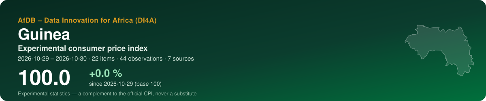
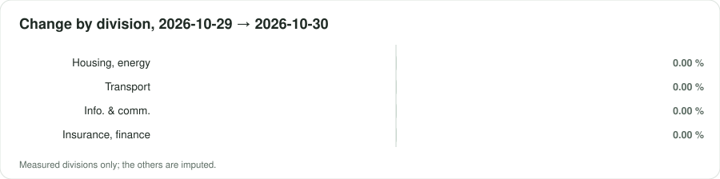
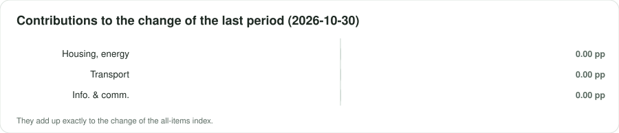

<p align="center"></p>

<p align="center">
  <a href="https://datainnov4africa-web.github.io/cpi-gn/"><b>▶ Open the live dashboard</b></a> · <a href="README.fr.md">Version française</a>
</p>

<p align="center">
      
</p>

## At a glance

| Indicator | Value |
|---|---|
| **All-items index** | **100.0** (+0.0 % since 2026-10-29) |
| Last period change | +0.00 % |
| Window | 2026-10-29 → 2026-10-30 · by collection date |
| Data | 44 observations · 22 items · 7 sources |
| COICOP divisions measured | 3 / 13 |
| Weights | official — Institut National de la Statistique (INS), 'Indice National Harmonisé des Prix à la Consommation (INHPC)', monthly note for June 2026 (Note_ |
| Currency | GNF (FG) |

> [!IMPORTANT]
> Experimental statistics built from prices published online (shops, regulators, utilities, market data). A complement to the official consumer price index of the national statistics office — never a substitute.

<p align="center"></p>

## Key messages

| Confidence | Message | Why |
|---|---|---|
| 🟠 Low | Between 2026-10-29 and 2026-10-30, the experimental index moved by +0.0 % (2 periods, 22 items). | Collection dates within a single month: a short-term movement, not yet a monthly trend. |
| 🟡 Medium | Over the last period, the largest contribution comes from division 08 (Information and communication): +0.00 percentage point. | Contributions add up exactly to the change of the all-items index. |
| 🟠 Low | The divisions measured weigh 22 % of the official basket. | Being reached is not being represented: a group can be followed through a few online items far from its official varieties. Unmeasured groups are imputed by the measured ones. |
| 🟡 Medium | Sampling of items: the latest index lies between 100.0 and 100.0 in 90 % of 100 bootstrap replications. | The interval covers which items were collected, not the bias of online prices against shop prices. |

## By COICOP division

<p align="center"></p>

| | Division | Weight % | Items | Change % | Contribution, last period (pp) |
|---|---|---:|---:|---:|---:|
| 01 | Food and non-alcoholic beverages | 39.3 | — | imputed | — |
| 02 | Alcoholic beverages, tobacco and narcotics | 0.7 | — | imputed | — |
| 03 | Clothing and footwear | 7.5 | — | imputed | — |
| 04 | Housing, water, electricity, gas and other fuels | 4.6 | 8 | 0.00 | 0.000 |
| 05 | Furnishings, household equipment and maintenance | 3.3 | — | imputed | — |
| 06 | Health | 3.7 | — | imputed | — |
| 07 | Transport | 10.8 | 2 | 0.00 | 0.000 |
| 08 | Information and communication | 6.5 | 5 | 0.00 | 0.000 |
| 09 | Recreation, sport and culture | 1.4 | — | imputed | — |
| 10 | Education services | 1.0 | — | imputed | — |
| 11 | Restaurants and accommodation services | 16.8 | — | imputed | — |
| 12 | Insurance and financial services | 0.0 | 7 | 0.00 | — |
| 13 | Personal care, social protection and miscellaneous | 4.5 | — | imputed | — |

*Imputed*: no price was read for the division; it moves with the measured ones (CPI Manual 2020, ch. 6).

<p align="center"></p>

## Sources

11 active sources in the register, 20 excluded with their reason. Every robot request reads robots.txt first; a refusal is recorded, never circumvented.

| Source | Type | COICOP | Status | Observations this run |
|---|---|---|---|---:|
| [Orange Guinée — mobile data bundles (weekly and monthly)](https://osiris.sn/cout-de-l-internet-quelle-est-la-place-de-la-guinee-par-rapport-a-ses-voisins.html) | regulated tariff | 08 | partial | 10 |
| [SEG — domestic water tariff by consumption band](https://guineenews.org/2025/03/30/pour-resoudre-linsuffisance-deau-et-delectricite-en-republique-de-guinee-faut-il-ouvrir-les-monopoles-la-societe-des-eaux-de-guinee-seg-et-lelectricite-de-guinee-edg-a-linvestissement/) | regulated tariff | 04 | partial | 8 |
| [Société Générale Guinée — retail banking fee schedule (individuals)](https://guinee.societegenerale.com/fileadmin/user_upload/guinee/PDF/Tarifs_Clipri.pdf) | regulated tariff | 12 | partial | 8 |
| [EDG — household electricity tariff by consumption band](https://guineenews.org/2025/03/30/pour-resoudre-linsuffisance-deau-et-delectricite-en-republique-de-guinee-faut-il-ouvrir-les-monopoles-la-societe-des-eaux-de-guinee-seg-et-lelectricite-de-guinee-edg-a-linvestissement/) | regulated tariff | 04 | partial | 6 |
| [Orange Money Guinée — withdrawal fee grid](https://guineenews.org/2025/01/15/monnaie-electronique-orange-money-reduit-encore-ses-frais-de-retrait-de-1/) | regulated tariff | 12 | partial | 6 |
| [Government pump prices — petrol and diesel](https://guineenews.org/2022/06/01/guinee-le-prix-du-litre-dessence-passe-de-10-mille-a-12-mille-gnf-officiel/) | regulated tariff | 07 | verified | 4 |
| [Government pump price — kerosene (pétrole lampant)](https://guineenews.org/2022/06/01/guinee-le-prix-du-litre-dessence-passe-de-10-mille-a-12-mille-gnf-officiel/) | regulated tariff | 04 | partial | 2 |
| [INS — INHPC monthly note, Tableau 21 'average prices of essential products by region'](https://stat-guinee.org/images/Documents/Publications/INS/infra_annuelles/IHPC/INHPC_2026/Note_INHPC_Juin_2026_Guinee_V1.pdf) | market prices | 01, 04, 07 | partial | 0 |
| [World Bank RTFP — monthly food price estimates by product and market (20 markets)](https://microdata.worldbank.org/catalog/6165) | market prices | 01 | partial | 0 |
| [World Bank — official CPI (annual)](https://api.worldbank.org/v2/country/GIN/indicator/FP.CPI.TOTL) | official benchmark | — | partial | 0 |
| [IMF DataMapper — inflation (WEO)](https://www.imf.org/external/datamapper/api/v1/PCPIPCH/GIN) | official benchmark | — | partial | 0 |

<details><summary>20 excluded sources and why</summary>

- **WFP market prices (HDX)** — Dataset 'Guinea - Food Prices' exists but covers 15 Jan 2008 - 15 Oct 2023 (last modified 18 Aug 2024, labelled 'every month'): three years stale. The INS price table and RTFP carry 2026 prices instead. Re-activate if updates resume.
- **FEWS NET — Guinea** — The FEWS NET Guinea page lists no analysis after the Key Message Update of March 2017 and no Guinea price bulletin; the Data Explorer was not reachable. No recent Guinea price data to expect.
- **Ministry of Commerce — ceiling prices of staples (Ramadan/Lent 2026)** — Protocol signed 16 Feb 2026 (DNCIC, Ministry of Commerce) capping prices of imported rice, sugar, vegetable oil, onion, milk powder, flour and chicken until 30 June 2026, with a grid for Greater Conakry. No figure was readable (KOACI gives none; the AllAfrica copy failed to load) and the caps have expired. Second deep pass: the AllAfrica copies were read. 17 Feb 2026: signatories DNCIC, CCIAG and Customs (DGD); Customs keeps reference values of USD 100/t for rice, 200/t for sugar, 600/t for chicken; the price table 'ci-dessous' is missing from the text. 18 Feb 2026 (Aminata.com): one figure only, 'le sac de 50 kg [sucre] ne doit pas excéder 350000 à Conakry'; each prefecture gets its own ceiling. An earlier protocol in force from 12 Jul 2025 (Guinéenews, 8 Jul 2025, publireportage) covered rice, sugar, oil, flour, onion, chicken and meat in Conakry, also without published figures. One expired ceiling on one product: not usable; the full grids are requested from the DNCIC.
- **Press market-price reports, Conakry ('panier de la ménagère')** — Read 2026-10-29: Guinéenews, 8 Mar 2025, unnamed Conakry markets: Bangladesh rice 315,000 GNF per 50 kg bag, sugar 350,000 per 50 kg, vegetable oil 310,000 per 20 L, palm oil 250,000 per 20 L, beef 60,000/kg, eggs 50,000–60,000 per tray. Similar pieces appeared in Aug 2023, Jan 2024 and Mar 2024, mostly around Ramadan; none was found for 2026. Irregular, unnamed markets, ranges, and per-kg figures that do not match the bag prices (350,000/50 kg given as '8,000 GNF le kilogramme'): a cross-check for the INS table at best, not a series.
- **Official bread price (baguette)** — Bread is price-controlled: a communiqué of the Minister of Commerce (about 3 Dec 2021) raised the single baguette from 2,000 to 2,250 GNF and the double from 4,000 to 4,500 GNF (Guinéenews, 4 Dec 2021). A Ministry of Commerce communiqué of July 2025 (AllAfrica, 25 Jul 2025) warns bakers against 'injustifiée' increases and refers to 'prix officiels' and 'la réglementation en vigueur', but gives no figure. The price in force in 2026 is therefore not confirmed; bread is also in the RTFP product list. Re-activate with the current ministerial text.
- **FAO GIEWS country brief / FPMA tool — Guinea** — Read 2026-10-29: the GIEWS country brief for Guinea is dated 21 March 2025 and gives food inflation only (7.7–9 % in 2024, 7.1 % in January 2025), no market price; it cites the FPMA tool without naming a Guinea series. Two searches found no FPMA Guinea price series (e.g. Conakry rice) to confirm. Re-check the FPMA tool from a browser.
- **Cement price (50 kg bag)** — Read 2026-10-29: trade press (27 Jun 2025) reports a shortage with bags at GNF 95,000–100,000, up from 70,000–75,000 for 42.5 grade, without saying whether any price is administered. No ceiling text was found. A single press range from 2025 for a small item of 04 (maintenance materials): not used.
- **Urban and inter-urban passenger fares (June 2022)** — Fares were set on 10 June 2022 by the Direction Nationale des Transports Terrestres and the national transporters' federation after the fuel increase. Deepening pass: the urban (25 Jun 2022) and inter-urban (27 Jun 2022) articles were re-read and both tables are absent from the text served (headings only, probably images). The only readable fares are one route, Conakry–Kankan: minibus 130,000 → 150,000 GNF and taxi 200,000 → 220,000 GNF (Guinéenews, 8 Jul 2022), with no later confirmation. One inter-urban route from 2022 does not represent passenger transport; no urban fare was found. Re-activate with the DNTT table. Second deep pass: one more search (urban taxi, minibus and bus fares 2025–2026) found only a Sep 2021 readjustment article and crowd-sourced taxi estimates.
- **Butane (LPG) refill prices** — Price in force unknown. Administered prices from 1 Sep 2021 (Ministry of Hydrocarbons protocol of 17 Aug 2021): 6 kg 69,000 GNF, 12.5 kg 143,500 GNF (Guinéenews, 30 Aug 2021). FAPGAZ communiqué of 2 Aug 2023 cut them to 60,000 and 130,000 GNF, but two weeks later retailers still charged 65,000–80,000 for 6 kg and an importer called the cut a 'proposition' pending a joint ministerial order (Guinéenews, 16 Aug 2023). No later text found. LPG also serves few households (charcoal dominates, INS table). Second deep pass: one more search (6 kg and 12.5 kg prices 2025–2026) returned only the 2021 and 2023 articles.
- **Public university master's fees** — One item only: master's fees in public institutions cut to 8,000,000 GNF a year (16,000,000 for the cycle), announced on the minister's Facebook page (Guinéenews, 21 Feb 2025), no text or effective date. It would make division 10 look covered while measuring a small slice of household education spending. Deepening pass: no licence registration fee for public universities (UGANC or others) and no school tuition list was found. Second deep pass (two searches): no 2025-2026 registration fee text for public universities; the Kofi Annan University profile on an education directory (updated 23 Jan 2026) shows no fee, and a reader's question of 19 Oct 2026 about 2026-2027 fees is unanswered.
- **Private schools — capped registration fees (MEPU-A, 2022)** — Communiqué of the Minister of Pre-University Education (30 Aug 2022), from the 2022-2023 school year: registration in private schools capped at 150,000 GNF and re-registration at 100,000 GNF nationwide. These are ceilings, not prices paid, they exclude the monthly tuition that makes up most of the spending, and nothing confirms them for 2025-2026 (a consumer union complained on 6 Sep 2025 of 'fixation fantaisiste' of private-school fees, without figures). Not representative of division 10.
- **Online shops / marketplaces (groceries, clothing, furnishings, personal care)** — No Guinean web shop with GNF prices was found in ten searches over two passes (groceries, clothing, cosmetics, furniture, appliances, supermarket web shops, Shopify/WooCommerce shops with 'GNF' and 'ajouter au panier', CoinAfrique — which returned nothing for Guinea). No Jumia marketplace for Guinea is known. Platforms found are app-only (MonMarché, Arabinene, Fifoow, launched Feb 2026: classified ads, no prices in the article) or second-hand (Seconde Main 224, sellers set prices: not CPI-relevant). Supermarkets in Conakry have no online price list. Divisions 03, 05 and 13 stay imputed. Second deep pass (five more searches: 'boutique en ligne Conakry GNF', supermarket chains Prosper/City Dia/Leader Price with web shops, phones and appliances, cosmetics/parapharmacy/clothing, and the exact phrase 'Ajouter au panier' with 'GNF'): only web-agency blogs, app listings and currency converters; no shop with a GNF catalogue.
- **Rent and classified-ad portals (Conakry)** — Two searches found no rent portal with dated GNF listings for Conakry; only press features on the housing crisis and holiday-rental sites (USD, tourists).
- **Food-delivery apps and restaurant menus (Dineroo, GuiFood, Clic GN)** — Mobile apps only, no public web menu with prices. Deepening pass (four searches): Clic GN is a student delivery app whose menus are 'within the app' (App Store listing); no Glovo or Yango Food service in Guinea was found; no Conakry restaurant publishes a dated price list on the web (directories and review sites carry no prices). Division 11 (16.8 % of the weights) stays imputed. Second deep pass (four searches): Glovo/Yango/Jumia Food 2026 news concerns Côte d'Ivoire and Nigeria only, no Conakry launch; no fast-food or restaurant site with a GNF menu; no published price for university canteen meals. Only crowd estimates remain (lunch menu 103,707 GNF, fast-food combo 73,835 GNF on Expatistan; see gn_cost_of_living_sites).
- **Hotel rates in Conakry (booking metasearch)** — Read 2026-10-29: nightly rates in EUR for a given stay (31 Oct–1 Nov 2026), e.g. Hakaba 35 €, Zambezi Inn 48 €, Palm Camayenne 193 €, Radisson Blu 357 €, with the same hotel shown at two prices on one page (Onomo 143 € and 114 €). Business/tourist hotels priced in euros, dynamic and stay-specific: they measure a negligible part of household spending in division 11, which the EHCVM weights put mostly on meals away from home. Robots.txt not read; travel metasearch sites usually disallow result pages. Second deep pass: a search for Conakry hotels' own rate pages in GNF returned only aggregators (combien-coute, Kayak, Momondo, Skyscanner, lastminute), no hotel's dated rack-rate page.
- **Cost-of-living aggregators (combien-coute.net, Numbeo, Expatistan)** — Read 2026-10-29: 'plat pour le déjeuner' average 8.3 €/person (about 82,179 GNF), range 4.1–12 €, updated 21/10/2026, data credited to Numbeo, number of contributions not stated; the same site and Expatistan also list beer, cigarettes and hotel nights. Expatriate-oriented crowd estimates converted to euros, unknown sample, not household prices: not usable for 02 or 11.
- **Beer and cigarette retail prices** — One search found no administered or published retail price for beer or cigarettes in Guinea: only crowd-sourced cost-of-living pages (see gn_cost_of_living_sites) and a 2020 tobacco-tax factsheet. Division 02 weighs 0.66 % and stays imputed. Second deep pass: one search on the national brewery (Sobragui) found a single launch price, Guiluxe 65 cl at 10,000 GNF (Guinéenews, 29 Sep 2024, stated by the brand manager, not called a recommended retail price); no price list and no cigarette price.
- **Areeba (ex-MTN Guinée) and Cellcom — data bundles and mobile-money fees** — No dated price list found in seven searches (operator bundles, MoMo fees, ARPT observatory). MTN left Guinea: the State bought its stakes on 30 Dec 2024 and owns 100 % of Areeba Guinée SA since a decree of 11 Dec 2025 (OSIRIS, 12 Dec 2025). The joint order AC/2024/141 (in force 1 Jan 2025) sets operator charges of 10–15 GNF/min, not retail prices, and the ministry said they would not be passed on (Guinéenews, 19 Mar 2025). A 2026 blog gives only '~2–3 %' transaction fees for Orange Money and MoMo, without source. Operator sites could not be reached. Second deep pass (three searches: Orange Guinée bundle pages, Areeba/Cellcom 2026 bundles, ARPT tariff observatory): only travel-eSIM sites, a 2022 Orange article without prices, and a regional telecom-observatory page that came back empty.
- **Medicine prices and public consultation fees** — No published PCG, DNPM or pharmacy price list and no public-hospital fee grid found (four more searches in the deepening pass). The national essential medicines list (WHO, 2021) has no prices. A DNPM workshop on lowering medicine prices (port tax cuts) sent a draft text to ministries, not yet adopted (Guinéenews publireportage, 17 Mar 2025). No online pharmacy with GNF prices. Division 06 (3.7 %) stays imputed. Second deep pass (two searches: consultation fees at the Donka and Ignace Deen university hospitals; a decree on the medicine price structure or PCG public prices): only a 2019 ministerial promise to review hospital fees, the 2022 decree on Donka's status (no tariff) and foreign hospitals' fee lists.
- **Motor third-party insurance premiums** — One search for a national motor third-party tariff (minimum premium by vehicle class) found no tariff text and no insurer price list; only a 2020 press piece on insurance fraud. Guinea is not in the regional insurance code zone, so no regional tariff applies by default. Division 12 has an official weight of 0 here.

</details>

## Method

Matched items; elementary **Jevons** indices by COICOP 2018 class, outlets as equal-weight strata; explicit imputation of missing prices (two periods at most, eleven for seasonal items); replacements linked with a quantity adjustment; aggregation with official weights in the **Young/Lowe** form, chained; GEKS as a chain-drift check; a 90 % bootstrap interval. As prescribed by the *Consumer Price Index Manual: Concepts and Methods* (IMF et al., 2020). Details: [docs/METHODOLOGY.md](docs/METHODOLOGY.md).

## Data

Open, machine-readable copies of what the dashboard shows:

- [`data/index_all_items.csv`](data/index_all_items.csv) — all-items index by period, with its 90 % interval
- [`data/index_divisions.csv`](data/index_divisions.csv) — index of each measured division
- [`data/contributions.csv`](data/contributions.csv) — contributions of the divisions to each change, in percentage points
- [`data/basket.csv`](data/basket.csv) — weights, items and change by division
- [`data/sources.csv`](data/sources.csv) — the source register and what this run obtained from each source
- [`data/metadata.json`](data/metadata.json) — country, periods, weights and key figures

## Reproduce

The index is produced by the open toolkit **cpi-di4a** in two notebooks: notebook 1 collects prices politely (robots.txt first, identified robot) and seals them in an archive; notebook 2 classifies, computes and publishes this repository. Set the country code, *Runtime → Run all*.

## Cite

```text
AfDB – Data Innovation for Africa (DI4A) (2026). Experimental consumer price index — Guinea. https://datainnov4africa-web.github.io/cpi-gn/
```

See also [CITATION.cff](CITATION.cff).

---

<p align="center"><sub>AfDB – Data Innovation for Africa (DI4A) · generated on 2026-10-29 · code under MIT licence; collected data remain subject to each source's terms</sub></p>
